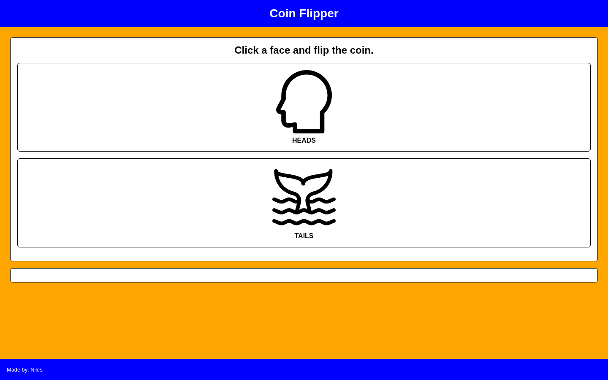

# Simple Coin Flip Game

Choose heads or tails and see whether your pick matches a server-generated coin flip.

## Overview

Simple Coin Flip Game lets a player choose heads or tails, then sends that choice to a Node.js server.

The server randomly generates the coin result, compares it with the player's selection, and returns whether the player won or lost. The result is then displayed in the browser.

## Features

- Choose heads or tails
- Random coin result generated on the server
- Win or loss result based on the player's selection
- Browser interface for repeated rounds
- Node.js HTTP server and API endpoint

## Technologies

<p>
  <a href="https://developer.mozilla.org/en-US/docs/Web/HTML" title="HTML">
    
  </a>
  &nbsp;
  <a href="https://developer.mozilla.org/en-US/docs/Web/CSS" title="CSS">
    
  </a>
  &nbsp;
  <a href="https://developer.mozilla.org/en-US/docs/Web/JavaScript" title="JavaScript">
    
  </a>
  &nbsp;
  <a href="https://nodejs.org/" title="Node.js">
    
  </a>
</p>

## How to Run

1. Clone the repository:

```bash
git clone https://github.com/nilesleesmith/simple-coin-flip-game.git
```

2. Open the project folder:

```bash
cd simple-coin-flip-game
```

3. Start the Node.js server:

```bash
node server.js
```

4. Open the application in a browser:

```text
http://localhost:8000
```

No additional packages or installation steps are required.

## Live Site

https://simple-coin-flip-game.onrender.com

## Screenshots



## Image Credits

- Head icon: Gregor Cresnar / Flaticon
- Whale-tail icon: Fahrul Saputra / Flaticon